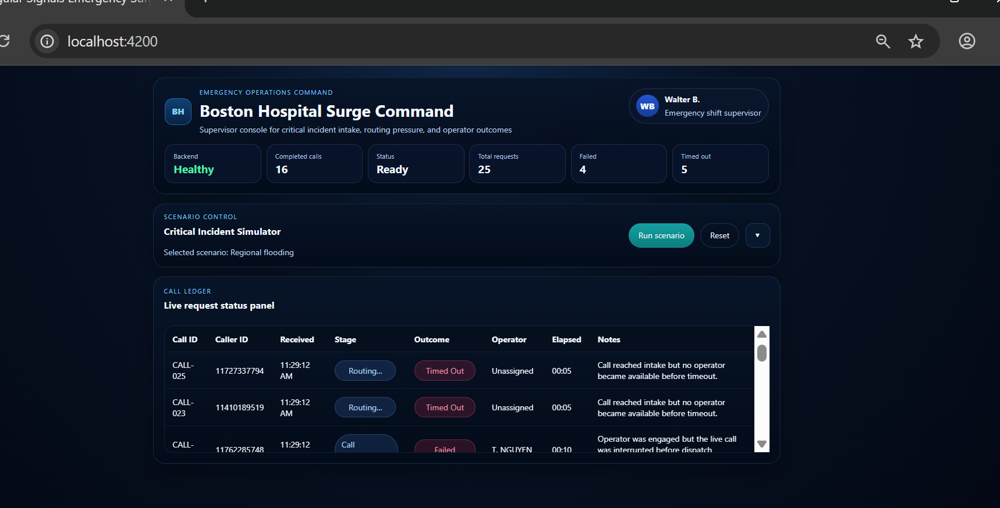

# Emergency Surge MVP | Azure CI/CD, Deployment & Observability

**A hands-on software delivery case study:** getting a functional healthcare-scenario MVP deployed, validating application connectivity, exercising a backend endpoint under load, and investigating real telemetry from AKS.

> **Focus of this repository:** Azure **application delivery / CI/CD**, **release verification**, **performance testing (P90)** and **Application Insights observability (P50/P95)**. The Angular UI and Node.js API are the working software used to demonstrate these skills—not a bid to showcase Node.js specialization, infrastructure engineering, or SRE operations.

## The client scenario

One of our healthcare-related clients asked for an MVP with a **Node.js backend that could be deployed, tested and monitored with Azure-native tools**. Node.js and Azure were being evaluated as possible backend/platform choices for a later implementation; the choice did **not** imply replacing an existing .NET stack.

The scenario was an **Emergency Surge** module for an existing healthcare triage platform: a supervisor-oriented view of exceptional incoming-call pressure, outcomes, backend availability, and recovery. This is a **publicly recreated simulation**, not client-owned production software or real patient data.

The engineering task was broader than implementing the dashboard: **deliver a functioning application, verify its deployment, test a defined workload, observe requests, and troubleshoot the gaps between expected and actual runtime behavior.**



## The practical evidence — 60-second review

| Engineering question | What was done | Original evidence |
|---|---|---|
| **Can the application be delivered to Azure?** | Angular and Node.js Docker images in ACR; Azure DevOps deployment pipelines applied Kubernetes manifests and checked AKS rollout state. | [Backend pipeline](screenshots/04-azure-devops-backend-pipeline.png) · [Frontend pipeline](screenshots/05-azure-devops-frontend-pipeline.png) |
| **What happens during a release problem?** | Dev/QA/Prod environment exercise and a **controlled production rollback/recovery drill**, including frontend/backend communication failure and restored connectivity. | [Failure](screenshots/06-prod-recovery-failure.png) · [Recovery](screenshots/07-prod-recovery-success.png) |
| **What did the load test measure?** | Azure Load Testing against **GET `/loadtest/ping`**: **79,334 requests; P90 9.00 ms; 708.34 requests/sec reported; 0% errors** in the captured run. | [Azure test summary](screenshots/08-azure-loadtest-p90.png) |
| **Was the backend observable inside AKS?** | Node.js OpenTelemetry/Azure Monitor bootstrap; runtime log verification; Application Insights requests associated with the AKS role instance; KQL P50/P95. | [AKS request evidence](screenshots/11-aks-telemetry-role.png) · [KQL results](screenshots/12-appinsights-p50-p95.png) |
| **Was a real issue diagnosed?** | Fixed a Docker startup path that bypassed the instrumentation preload and corrected telemetry configuration during the historical deployment. | [Telemetry initialization](screenshots/10-telemetry-startup-fix.png) |

**Measurement boundary:** P90 above comes from one **Azure Load Testing** run against a deliberately lightweight endpoint; it is **not** the end-to-end emergency-call workflow latency. The captured **Application Insights** screenshot is a **separate, smaller request sample**: 21 `/loadtest/ping` requests with **P50 1.319 ms / P95 1.9605 ms / zero recorded failures** (plus one `/health` request). These numbers must not be described as percentiles over the 79,334-request load-test dataset. See [performance & telemetry](docs/performance-and-observability.md).

## What was delivered

```text
Angular / TypeScript supervisor dashboard ──HTTP──> Node.js / Express API
    · operational status                              · /health
    · queued/active/final call states                 · /simulate/dispatch
    · failed/timed-out/offline scenarios              · /simulate/collapse
                                                      · /loadtest/ping
                                                      · structured logs + correlation ID
                                                      · Azure Monitor OpenTelemetry bootstrap

GitHub source ──> Azure DevOps historical deployment pipelines ──> AKS Dev
Docker images ──(historical manual build/push)──> ACR ──> AKS
                                                        │
                          Azure Load Testing ────────────┤
                          App Insights / KQL <───────────┘
```

The original **application deployment** pipelines are preserved under [`deployment/azure/historical/`](deployment/azure/historical/README.md). They performed **deploy + rollout verification**, not a full build/test/container-publish pipeline. Dev → QA → Prod image promotion included **manual steps**. Terraform provisioning and local Azure state are **not included**, by design: this repository is about an application's delivery and observability, not an IaC portfolio.

## Follow the evidence

1. [Azure delivery, pipelines, environment promotion and recovery](docs/azure-delivery-and-release-validation.md) — what was automated and what was manual.
2. [Load testing, instrumentation and KQL](docs/performance-and-observability.md) — what the results support (and don't).
3. [Implementation and engineering decisions](docs/application-and-engineering-decisions.md) — why the MVP is compact and why Node.js was used.
4. [Selected screenshot index](screenshots/README.md) — **15** curated captures (12 historical + 3 new local checks); no screenshot dump.
5. [`linkedin_images/`](linkedin_images/README.md) — **four** original images in publishing order.

## Code to inspect

- [`frontend/src/app`](frontend/src/app) — Angular Signals dashboard, HTTP service, queue/state lifecycle and offline UX.
- [`backend/src/routes/index.js`](backend/src/routes/index.js) — API simulation, health and dedicated measurement target.
- [`backend/src/middleware`](backend/src/middleware) — correlation IDs and request logging.
- [`backend/src/instrumentation.js`](backend/src/instrumentation.js) — optional Azure Monitor startup.
- [`backend/Dockerfile`](backend/Dockerfile) + [`backend/package.json`](backend/package.json) — `npm start` preserves instrumentation preload.
- [`deployment/azure/historical`](deployment/azure/historical/README.md) — real pipeline YAML and Dev/QA/Prod manifests, archived **as they were**, for review.

### Run locally without Azure

Requires Node.js and npm. No Azure subscription, ACR, AKS, telemetry connection string, or account is required.

```bash
# Terminal A
cd backend
npm ci
npm test
npm start

# Terminal B
cd frontend
npm install
npm start
```

Visit the Angular dev-server URL displayed by the CLI (normally `http://localhost:4200`). The frontend uses [`frontend/public/app-config.js`](frontend/public/app-config.js) for the API URL (default: `http://localhost:4001`), replacing an obsolete hard-coded Azure public IP. See [local development notes](docs/local-development.md) for deployment limitations. **Do not put credentials in the browser configuration.**

**Locally revalidated on November 7, 2026:** Angular compiled and served the dashboard, and Node.js handled a **25-call Regional flooding simulation** with **16 completed, 4 failed and 5 timed out**; deliberate error outcomes were visible in correlated structured logs. [Scenario controls](screenshots/13-local-scenario-configuration.png) · [Failure/timeout logs](screenshots/14-local-correlated-failure-timeout-logs.png) · [Completed dashboard](screenshots/15-local-completed-25-call-run.png). This is **local functional evidence only**, not a new Azure deployment or repetition of the historical performance measurements.

## Scope and historical status

- The Azure environment was **decommissioned** after historical capture. Links to old endpoints are not live; screenshots are historical, **not claims of a currently running service**.
- This is a **simulation MVP**, not a hospital-grade system: no actual patients, operator integrations, persistent queue/database, authentication, production SLAs, or full workflow load test.
- No claim of a completely automated CI/CD chain: Azure DevOps YAML applied existing images to AKS; image build/publish and some promotions were manual.
- No new Azure testing was conducted during repository preparation. A few local source hygiene changes and small offline unit tests were added; the captured metrics were **not** regenerated.
- This repo is **application engineering delivery evidence**, not a Node.js specialization claim, Terraform project, managed SRE service, or support desk portfolio.
